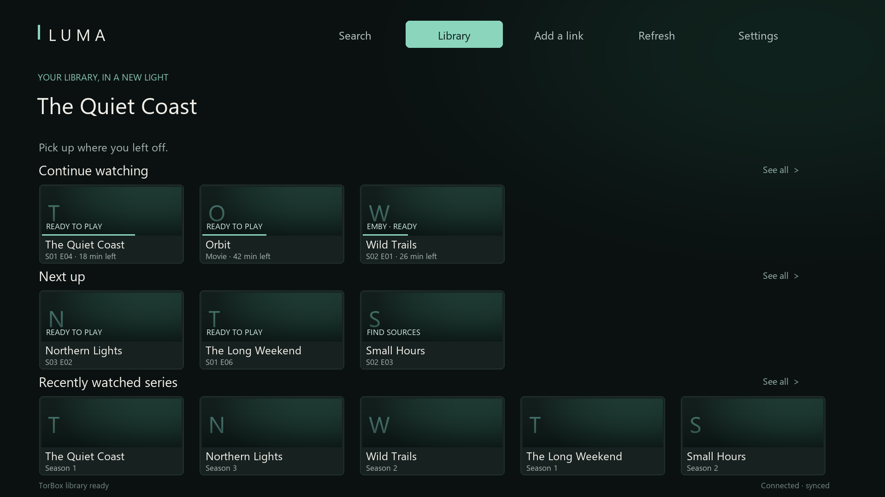

# Luma for Kodi

An original, lightweight Kodi video add-on built around TorBox and a quiet, TV-friendly home screen. Targets **Kodi 21 Omega**, Google TV Streamer (4K), and a Samsung S90F display.

**Status: 0.5.0 development alpha.** Adds long-press custom search filters, including alternate season/episode numbering with canonical watch history preserved. See [custom searches and the Bake Off example](docs/CUSTOM-SEARCH-FILTERS.md), [source/pack/sign-in behaviour](docs/SOURCE-VALIDATION-AND-PACKS.md) and [menu coverage](docs/SEREN-MENUS-AND-SETTINGS.md). The default main menu and optional visual **Home Dashboard** remain available. Live account/provider tests and Google TV playback still need the checks in [the validation guide](docs/DEVICE-VALIDATION.md).

## Install

**Kodi source:** [https://rwilli56.github.io/luma/](https://rwilli56.github.io/luma/)

1. In Kodi's **File manager → Add source**, enter `https://rwilli56.github.io/luma/` and name it `Luma`.
2. Choose **Add-ons → Install from zip file → Luma → repository.luma-0.1.1.zip**. Enable unknown sources if Kodi asks.
3. Choose **Install from repository → Luma Repository → Video add-ons → Luma → Install**.
4. Open Luma's Settings and enter your TorBox key. Optional Trakt and Emby setup is described below.

[Download the repository ZIP](https://rwilli56.github.io/luma/repository.luma-0.1.1.zip) · [Source code](https://github.com/rwilli56/luma) · [Publishing guide](docs/GITHUB-REPOSITORY.md)

For a direct local installation without the repository:

1. Build with `python tools/package.py`, or use `dist/plugin.video.luma-0.5.0.zip` from this workspace.
2. Transfer the ZIP to a folder or network share Kodi can access. In Kodi, enable **Settings → System → Add-ons → Unknown sources**, then choose **Add-ons → Install from zip file**.
3. Open **Luma → Tools → Open Settings Menu → Accounts**. Enter your TorBox API key from your dashboard.
4. Open **My Files → TorBox** to browse and play your files after the idle service refreshes them. The visual **Home Dashboard** also has a Refresh button. New transfers can take time to become ready.
5. Add Luma to Kodi favourites for quick access. Its home is an add-on window; it does not replace your Kodi skin or the Google TV launcher.

Kodi installs Requests from its official add-on repository for provider compatibility. Search backends are installed separately below. Python 3.8+ is the code compatibility target; local tests ran under Python 3.13. Estuary is the first skin to validate.

## Included

- TorBox torrent and web-download libraries, with pagination, video-file filtering, season-pack files and multiple quality versions.
- User-added magnet and HTTP(S) file links, submitted to TorBox for downloading.
- Movie and TV title search, season/episode selection, installed CocoScrapers and Magneto/POV provider adapters, duplicate-hash removal, and a TorBox-cached source chooser.
- Fresh TorBox playback links requested at play time; direct original-file playback through Kodi VideoPlayer.
- Selected-hash cache rechecks, actual-file validation, optional one-byte CDN link checks and bounded source failover. Bulk checks never open video streams.
- Season/episode and air-date matching, season-folder filenames, complete-pack season ranges and explicit confirmation for suitable unrecognized filenames. Per-file bindings survive library refreshes.
- Long-press **Custom search filters…** on movies, shows, seasons, episodes and dashboard cards. Save source title/year/IMDb, source season/episode/offset, title-only provider searches, and required/excluded release phrases. Show, season and episode scopes keep split catalogs isolated; Trakt and local progress retain the selected metadata numbering.
- Seren-style discovery, personal lists, actor search, genres, years, networks and maintenance menus; cached metadata and paginated lists. Most charts need a Trakt application Client ID; personal lists need Trakt sign-in.
- Continue watching, Next up, and recently watched series in **Home Dashboard**. Home rows show the first 20 entries; **See all** opens the complete saved list.
- Local SQLite resume storage, checkpoints every 10 seconds, and configurable resume behaviour. A normal stop can lose up to the last checkpoint interval. Natural ending or the configured completion threshold (90% by default) marks an item watched.
- Optional Trakt device sign-in, rotating-token refresh, paused progress, watched history, and an offline outbox.
- Optional local Emby browsing, direct original-file streams, imported resume points, and deferred server progress updates.
- A compatibility-first source chooser. The S90F defaults prefer common audio formats and HDR10+/HDR10 over filenames indicating Dolby Vision without an HDR10 fallback. Filename badges are hints; Kodi reads actual stream metadata.

This version has no automatic next-episode playback, external subtitle fetching, hoster-provider resolution, Emby Connect discovery, or transcoding. Downloads that are not fully present in TorBox cannot play. `.torrent` uploads, Usenet, disc structures and combined multi-episode files are outside this version. Supported filename patterns and conservative fallbacks are described in [the pack guide](docs/SOURCE-VALIDATION-AND-PACKS.md).

## Search providers

1. Update the **Luma video add-on** to **0.5.0** from Luma Repository. The repository add-on stays at 0.1.1.
2. Install **CocoScrapers Module** from [CocoJoe's repository](https://cocojoe2411.github.io/), or **POV** from [kodifitzwell's repository](https://kodifitzwell.github.io/repo/). Either backend is sufficient; you can use both. Current **Magneto delegates to POV**, so a separate Magneto installation is not needed.
3. Open **Tools → Provider Tools → Manage Provider Packages**, choose the installed backend and enable its torrent providers. Luma respects those switches. You can turn an entire backend off under **Tools → Open Settings Menu → Providers**. Provider-specific credentials, if required by an individual provider, belong in its own settings. Luma's TorBox key is used only by Luma's TorBox client.
4. Choose **Search** on Luma's main menu and select movies or shows. Browse a matching show into its seasons and episodes. The visual dashboard's Search button also offers title search.
5. Select a **TorBox-cached source**. The list shows filename hints for resolution, HDR, audio and size, sorted using the S90F playback preferences. A selected season pack is checked for the exact requested episode; multiple matching video files open a file chooser. Kodi then receives a fresh original-file playback URL.

Opening Continue watching or Next up searches providers when no ready local source exists. Library items also have **Find sources** in their context menu. Search is user initiated and disabled while a video is playing.

For alternate numbering such as *The Great British Bake Off*, long-press the metadata **Season 17 → Custom search filters… → Search season**, enter **10**, then **Save filters**. Episodes in that metadata season now search and match pack files using season 10, while progress remains season 17. From an episode, choose **This season** to apply the same rule. Other metadata seasons are unchanged. Additional title/year/ID hints may be needed when a provider uses a different catalog; see [the custom search guide](docs/CUSTOM-SEARCH-FILTERS.md).

With a Trakt application Client ID configured, title and episode metadata comes from Trakt, including exact sync IDs. Otherwise search uses [Stremio's official Cinemeta catalog](https://github.com/Stremio/stremio-official-addons/blob/master/index.json), without a separate account. Cinemeta often supplies only a series IMDb ID, not an episode IMDb ID; those episodes retain local progress until explicitly identified through Trakt. Luma never submits a series ID as an episode ID. Cinemeta receives title queries; enabled source providers receive title/year/IMDb and episode fields; TorBox receives torrent hashes and the selected magnet.

Adapters were checked against **CocoScrapers 1.0.45**, **POV 6.11.03** and the **Magneto 6.11.01** wrapper. Their current `sources(data, hostDict)` and optional pack interfaces are used directly. These third-party interfaces can change. Provider code is not included in Luma's MIT distribution, and a provider returning zero results may represent an upstream outage or filtering rather than a successful empty search.

For the Streamer, at most four provider tasks run at once. The default 20-second dispatch budget stops new tasks; active third-party requests must finish before source selection, and may exceed that budget. These limits are configurable under **Scraping**. Cancellation returns immediately and stops dispatch; a request already in flight may finish. Provider metadata can be reused for 15 minutes, but TorBox availability is checked afresh. Up to 1,000 preferred unique hashes are checked in batches of 100. Cached-only creation is requested again when adding the torrent. Cache status can change and account limits still apply. Uncached results are excluded; use **My Files → Add a link** to start a download explicitly. Hoster and HTTP results returned by providers are not resolved in this version.

## Frame-rate matching

**Set up Kodi frame-rate matching automatically** is enabled by default in Luma's playback preferences. Immediately before playback, Luma uses Kodi's local JSON-RPC interface to set:

| Kodi setting | Value |
| --- | --- |
| Adjust display refresh rate | On start/stop |
| Sync playback to display | Off |

These are persistent, Kodi-wide settings. Disable Luma's option to manage them manually. Luma reports setup failures and exposes the current settings under **Tools → Open Settings Menu → Shortcuts → Playback and connection status**. That display reports configuration, not proof of a physical HDMI mode switch.

Kodi receives the original stream without an invented frame rate. Its native demuxer and display system choose the available HDMI mode. This applies to both TorBox and Emby playback. Refresh switching depends on the modes Android, the TV and any intervening AVR expose; an exact 23.976 Hz output cannot be guaranteed by an add-on.

Kodi documents the difference between refresh switching and changing playback speed in [Player video settings](https://kodi.wiki/view/Settings/Player/Videos). The setting IDs and enum values were checked against [Kodi 21's settings definition](https://github.com/xbmc/xbmc/blob/Omega/system/settings/settings.xml).

## Connect Trakt

1. Create your own application in the [Trakt developer portal](https://developer.trakt.tv/). Follow its current app registration requirements.
2. Enter the application's **Client ID** in Luma's account settings. New device-flow applications start with the optional legacy Client Secret field empty; only use that advanced field if your existing application requires it.
3. Select **Tools → Open Settings Menu → Accounts → Connect Trakt**. If no Client ID is saved, Luma explains app registration and offers to accept it first. On your phone/computer, open the verification URL shown by Trakt and enter the displayed activation code. The Client ID and activation code are different values.
4. Trakt sync runs while Kodi is idle. It imports paused playback and all watched series, fetching show-progress details in batches of eight so a large history does not trigger one request burst. The first full Next up population may take several idle cycles.
5. For a new filename-only library title, long-press it in the library and select **Identify on Trakt**. Confirm the movie or series. Luma resolves episode IDs in the background. It never submits guessed title matches as watched history.

The login client uses `auth.trakt.tv`; data calls use `api.trakt.tv`. Tokens are saved and replaced on refresh, including rotating refresh tokens. See [Trakt's authentication guide](https://developer.trakt.tv/docs/authentication-oauth). This workspace does not include shared Trakt application credentials.

Local progress remains usable if Trakt is offline. Outbound updates wait in SQLite until sync succeeds. Local timestamps take precedence over older paused records from Trakt. Completion updates and subsequent partial rewatches use separate queue entries. A network failure after Trakt accepts an update but before responding can cause a retry; exactly-once remote history writes cannot be guaranteed.

Next up uses Trakt's aired-episode progress when connected. Offline, Luma advances only to a consecutive episode already in your library, within the same season. It does not guess season boundaries or skip missing episodes. Unfinished episodes belong in Continue watching. Opening a Trakt episode absent from your library searches installed providers for a TorBox-cached source.

Trakt artwork is downloaded to a local cache before display, with a 2 MB per-image limit and a 50 MB disk budget. Titles without artwork use the built-in initial-card design. The [Trakt image requirements](https://developer.trakt.tv/docs/images) prohibit direct image hotlinking.

## Connect a local Emby server

Under Luma's **Tools → Open Settings Menu → Emby**, enter:

| Field | Example / location |
| --- | --- |
| Server URL | `http://192.168.1.10:8096` or your HTTPS reverse proxy address; optional `/emby` suffix supported |
| API key or user access token | A token created in your Emby server dashboard |
| User ID | The ID of the user whose library/progress you want; available from your server's API browser user-list response or the user detail page URL |

After **Refresh**, the top library button offers **TorBox** or **Emby**. An administrator API key can access more than one user's data, so use the intended user ID. A restricted user token must have access to that same user.

Emby plays the original file over its static stream endpoint. Server progress is written when playback stops and the next idle library refresh runs, normally within five minutes; **Refresh** requests it sooner. Server resume data joins the home rows. This is a basic API-key connector: no server discovery, password sign-in, live-session reporting, Emby Next Up import, or Emby artwork yet. Original files must be decodable by Kodi on your hardware; this connector does not request a transcode to make an incompatible file playable. TorBox and Emby copies may appear separately.

The adapter follows [Emby's REST API](https://dev.emby.media/doc/restapi/index.html) and [static video streaming](https://dev.emby.media/doc/restapi/Video-Streaming.html) interfaces.

## Streamer / Samsung S90F setup

- Keep Kodi's Android **MediaCodec** and **MediaCodec (Surface)** hardware decoding enabled.
- With automatic frame-rate setup enabled, Kodi switches at start/stop. Leave time for the HDMI resync; a brief blank screen is expected. If exposed by your Kodi build, review the resolution/refresh whitelist and include the supported modes you intend to test.
- Set the TV's HDMI input up for its full UHD/HDR bandwidth. Confirm HDR/HDR10+ output using known test material; source names are not sufficient evidence.
- Keep Dolby Vision preference off for this S90F profile. Hybrid files still need testing because filenames do not establish their Dolby Vision profile or base layer.
- For TV speakers, let Kodi decode common formats. With an AVR/soundbar, enable only audio passthrough formats the entire HDMI/eARC path supports. The lossless preference changes ranking; it does not add hardware passthrough support.
- Use wired Ethernet where practical for high-bitrate originals. Do not apply an oversized Kodi RAM cache by default: Luma ships no `advancedsettings.xml` and does not alter buffer allocation.

Google lists [4K up to 60 fps, HDR10/HDR10+/HLG/Dolby Vision, 4 GB RAM and gigabit Ethernet](https://store.google.com/product/google_tv_streamer_specs?hl=en-US) for the Streamer. Samsung lists [HDR10+, HLG and Dolby Atmos](https://www.samsung.com/us/tvs/oled-tv/s90f-55-inch-55-class-oled-tvs90f-qn55s90fafxza-qn55s90fafxza/) for the S90F. Product support does not establish every Kodi/container/profile combination; use the device test matrix.

## Development and validation

```powershell
python -m unittest discover -s tests -v
python -m compileall -q plugin.video.luma
python tools/package.py
```

Tests use captured-shape fixtures and Kodi API doubles; they are not live service or video-decoding tests. The package script writes a deterministic ZIP and SHA-256 file in `dist/`, excluding tests, tools, bytecode and local account data.

To regenerate the skin and assets, install Pillow in your development Python environment, then run:

```powershell
python tools/build_ui.py
python tools/preview_ui.py
python tools/build_settings.py
```



This preview is rendered from the window XML using development tooling and fictional fixture titles. It is **not a Kodi screenshot**; actual font metrics and focus behavior must be checked in Kodi.

Runtime code is in `plugin.video.luma/resources/lib`: `torbox.py` and `emby.py` are source adapters, `app.py` routes navigation and playback, `display.py` configures native frame-rate matching, `monitor.py` owns playback tracking and background sync, `store.py` persists data, and `ui.py` drives the native window.

Credentials live only in the device's Kodi add-on profile/settings and are not encrypted by this alpha. Luma does not log request URLs, tokens or raw API responses. Kodi's own debug output may include resolved stream URLs; redact them before sharing logs. Playback metadata contains file IDs and local keys, not saved CDN URLs. All background network clients check for playback before starting additional batch requests; a request already in flight may finish after playback starts.

Umbrella, POV and Seren were used as feature references. See the reviews of [source-checking/pack methods](docs/SOURCE-VALIDATION-AND-PACKS.md) and [custom searches/alternate numbering](docs/CUSTOM-SEARCH-FILTERS.md). The provider adapters load the user's separately installed CocoScrapers or POV module; Luma does not package their provider code. MIT license covers Luma's original implementation.
