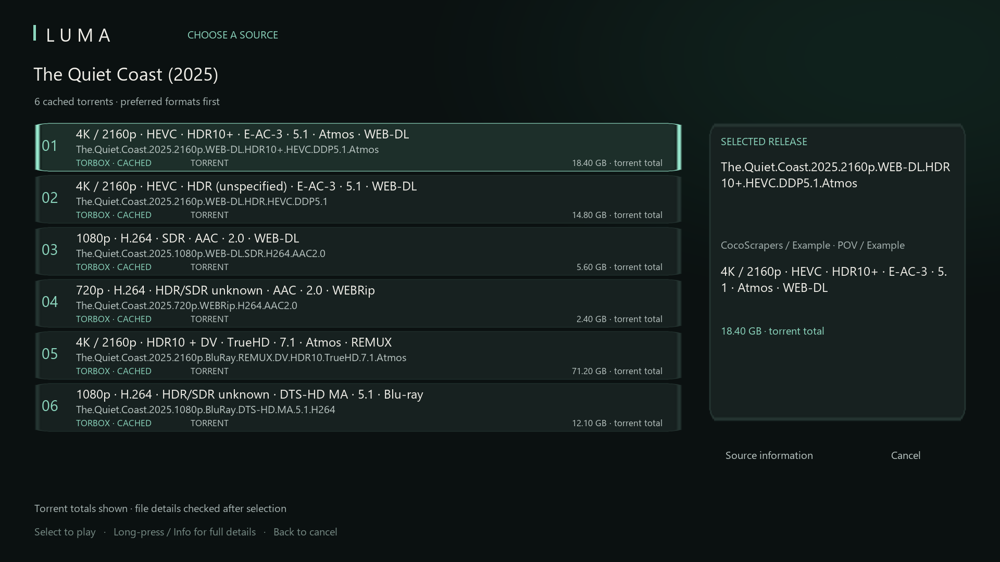

# Source selection and file information

Luma 0.6.0 replaces the compact source dialog with a native Kodi full-screen picker. Its numbered rows show resolution, codec, dynamic range, audio, channels, Atmos, release type, cache service, package type and size when those details are available. The focused panel keeps the full release name, provider names and numbering override visible. Move right to **Source information** or **Cancel**; select a row to continue. Long-press or press Info to read the complete source report without starting playback.

This image is generated from Luma's XML with fictional fixtures. It is a layout preview, not a Kodi screenshot. The installation uses native Kodi controls and existing Luma textures, with seven visible rows and no extra artwork downloads or background stream inspection.

## What the information means

| Information | Handling |
| --- | --- |
| Torrent total | TorBox cache/transfer bytes when available; covers the whole torrent, including a pack's other episodes |
| Provider estimate | Numeric provider GiB converted to bytes; remains an estimate because upstream rounding/unit conventions can vary |
| File size | The selected TorBox manifest file's bytes, never a pack total divided by an episode count |
| Units | Decimal GB/MB/KB for display, matching Luma's size-limit settings; Source information also shows the supplied byte count |
| Missing or invalid size | Shows **Size unknown**; negative, boolean, non-finite and malformed values cannot become a displayed size |
| Video/audio formats | Filename/folder/provider hints; Kodi reads the real stream tracks when playback starts |
| Cached | TorBox reported this torrent available at the last check; the selected hash and actual file are checked again before playback |

Bulk cache checks retain the existing 100-hash batches and 1,000-result bound. They do not fetch manifests for every result or open video streams. Actual file details are obtained only for the chosen transfer. Existing selected-link checking still uses its bounded one-byte request. The source picker itself makes no network calls.

For a single unambiguous file with consistent hints, playback continues without another selection step. Multiple files open the same picker in file mode, sorted by the file-level preferences. If a single file explicitly contradicts the release's format hints, selection playstyle shows the actual file first. Automatic playstyle keeps automatic behavior; actual file filters still apply. Unrecognized episode files continue to require explicit episode confirmation.

## Accuracy changes

- A generic `HDR` token stays **HDR (unspecified)**; it is not promoted to HDR10. No HDR tag is **HDR/SDR unknown**; an explicit `SDR` tag is distinct. `10bit` alone does not imply HDR.
- Dolby Vision is retained alongside explicit HDR10 or HDR10+ hints. Generic HDR does not establish an HDR10 fallback for a DV file. HLG is recognized separately.
- Codec/resolution matching uses token boundaries, avoiding substrings such as `AV100` or `Movie1080`. SD formats and interlaced labels such as `1080i` are retained.
- DTS-HD MA, DTS-HD HRA, DTS:X and plain DTS are distinguished. E-AC-3/DDP/DD+, AC-3/DD, TrueHD, AAC, FLAC, PCM, Opus and MP3 are recognized. Atmos and all named channel layouts are separate hints; they are not assigned to a specific audio track or treated as a passthrough guarantee.
- Explicit file hints win over folder/release/provider-quality hints. Inheritance occurs by related groups: an explicitly AAC file cannot borrow TrueHD/Atmos from its pack. A DV filename cannot borrow an HDR10 fallback merely from the parent release. Source information identifies the hint origins.
- Full TorBox paths are preserved; an inconsistent `short_name` cannot override the actual basename or its format hints. Empty/malformed file paths are skipped.
- Duplicate hashes remain one result while retaining all reporting provider names. Conflicting provider metadata is not proof of a file's actual tracks; the manifest filename takes precedence after selection.
- Fresh manifest validation updates the selected source's path, size and format hints. Playback filters are applied again before handing the URL to Kodi, so an old 4K badge cannot bypass a refreshed 1080p file's restrictions. Canonical episode IDs, custom source-numbering context and progress remain intact.

## Umbrella review

Reviewed Umbrella's official Kodi 21 [source-results Python window](https://github.com/umbrellaplug/umbrellaplug.github.io/blob/master/omega/plugin.video.umbrella/resources/lib/windows/source_results.py) and [XML layout](https://github.com/umbrellaplug/umbrellaplug.github.io/blob/master/omega/plugin.video.umbrella/resources/skins/Default/1080i/source_results.xml) on November 18, 2026. The useful patterns are numbered detailed releases, quality/service/provider/size fields, a persistent information panel and a source-information context action. Luma implements these patterns in its own charcoal/teal layout and original code; no Umbrella code or artwork is bundled.

TorBox's [official torrent API documentation](https://github.com/TorBox-App/torbox-sdk-py/blob/main/documentation/services/TorrentsService.md) documents cache availability separately from transfer-file access. Luma keeps this distinction in the picker and labels torrent totals separately from selected-file sizes.

Automated fixtures cover report formatting, malformed sizes, HDR and audio variants, file/folder precedence, provider deduplication, exact file selection, cancellation, preserved numbering overrides and post-refresh filtering. Native Kodi remote rendering, real-account results and Streamer playback remain device checks in [the validation guide](DEVICE-VALIDATION.md).
